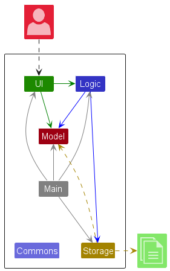

# UniCa$h: architecture

> [!NOTE]
> This architecture write-up was added by
> [Claude Opus 5.5](https://docs.anthropic.com/en/docs/claude-code) in Nov 2026 using my
> [agentic-repo-analysis](https://github.com/sp4ce-cowboy/agentic-workflows) skill, from the
> project's code, git history and documentation.

A short technical tour of UniCa$h, focused on the parts I built. The team's full
[Developer Guide](https://ay2324s1-cs2103-t16-3.github.io/tp/DeveloperGuide.html) has the rest. Back to the [README](README.md).

## 1. Starting point

UniCa$h began as AddressBook-Level3 (AB3), the course's 10,000-line brownfield Java codebase, and
was refactored into a finance tracker: persons became transactions (name, amount, type, date,
location, categories), and budgets, summaries and a rolling balance were added.

| Component | Role |
|---|---|
| **UI** | JavaFX views defined in FXML; observes the model's filtered list |
| **Logic** | `UniCashParser` turns a line into a `Command`; `execute` returns a `CommandResult` |
| **Model** | Transactions, budget and the filtered list in memory |
| **Storage** | JSON on disk, read at start-up and written after each command |

## 2. The UI overhaul

- **Layout:** an adjustable vertical `SplitPane` between the transaction list and a larger results
  box; the list reversed so the newest transactions sit on top; custom fonts and an app icon.
- **One `StyleSheet` class** ([source](https://github.com/sp4ce-cowboy/tp/blob/52513265da923537713fc58a048d7f7741ee3fc6/src/main/java/unicash/ui/StyleSheet.java)) holds every colour used in code, so a
  future theme only has to change one place.
- **Category colours from hashes** ([`getColorFromHash`](https://github.com/sp4ce-cowboy/tp/blob/52513265da923537713fc58a048d7f7741ee3fc6/src/main/java/unicash/ui/StyleSheet.java#L50-L68)): the hex
  digits of a category's hash code give its colour, padded and offset to stay readable, so every
  category keeps one colour everywhere with no table to maintain.
- **Rolling balance** ([`StatusBarFooter`](https://github.com/sp4ce-cowboy/tp/blob/52513265da923537713fc58a048d7f7741ee3fc6/src/main/java/unicash/ui/StatusBarFooter.java#L40-L70)): the footer listens
  to the filtered list and totals whatever is shown: the whole balance at start-up, or the spend of
  a search.
- **Command history** ([`CommandBox`](https://github.com/sp4ce-cowboy/tp/blob/52513265da923537713fc58a048d7f7741ee3fc6/src/main/java/unicash/ui/CommandBox.java#L55-L90)): the last 10 inputs on the up
  and down arrows, `ESC` to clear, like a terminal.

## 3. Commands

| Command | What it does | Notes |
|---|---|---|
| `delete`, `clear_transactions` | Remove one or all transactions | Clear goes through its own parser, so mass deletion is deliberate |
| `reset_unicash` | Restore the default sample data | For new users and testers |
| `get` | Show one transaction in full | For fields longer than the list can display |
| `find` | Search by name, category or location | One predicate per property, combined to match all keywords ([source](https://github.com/sp4ce-cowboy/tp/blob/52513265da923537713fc58a048d7f7741ee3fc6/src/main/java/unicash/model/transaction/predicates/TransactionContainsAllKeywordsPredicate.java)) |
| `help` | Command list, also the welcome window | Later extended by Lip Wei |

**Tried and removed:** a fuzzy find across every property, a matching AND-filter, and a local PDF
user guide. They were cut for scope and testability, and the find command took the useful parts.

## 4. Testing

- `UserInputBuilder` ([source](https://github.com/sp4ce-cowboy/tp/blob/52513265da923537713fc58a048d7f7741ee3fc6/src/test/java/unicash/testutil/UserInputBuilder.java)) builds
  keystroke sequences for TestFX's `FxRobot`, so UI tests can type commands like a user.
- UI tests cover the command box and its history; unit tests cover the style sheet and the commands.
- CI on GitHub Actions runs the build and tests on every pull request, with coverage on Codecov.

## 5. Process

- Set up the team's GitHub organisation, a shared meeting-minutes document, and a test branch with a
  `TestCommand` for internal testing.
- Renamed the codebase from AB3 to UniCa$h.
- Managed releases v1.3b (with a demo video) and v1.3.1.
- 43 pull requests opened (36 merged), 54 reviewed.

## 6. Next steps

From the Developer Guide's planned enhancements: find on more properties (date, amount, type), and
user-selectable themes built on the `StyleSheet` class.
