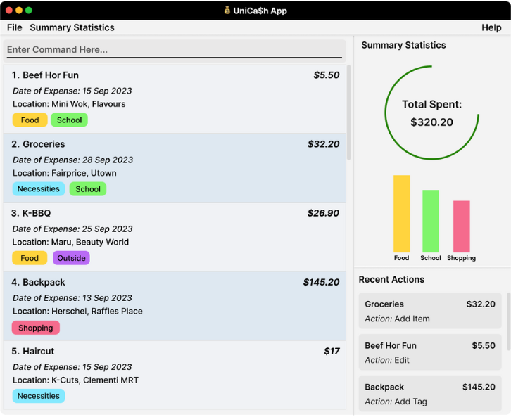
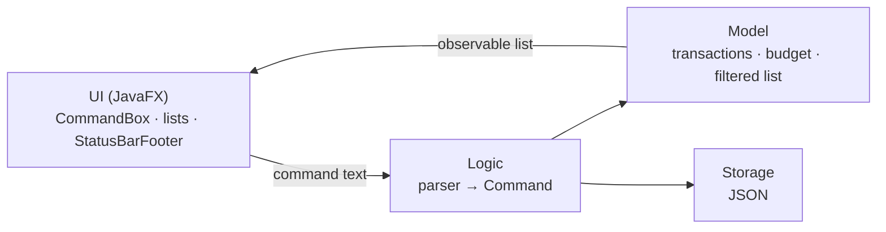

<div align="center">

# UniCa$h

**Personal finance tracking for university students, from the keyboard.**<br>
A desktop app where students log income and spending, set budgets and see where their money goes,
through a command line with a JavaFX interface. Built by a team of five for NUS CS2103, on a
brownfield Java codebase grown to about 20,000 lines.

**[Product site](https://ay2324s1-cs2103-t16-3.github.io/tp/)** · [User Guide](https://ay2324s1-cs2103-t16-3.github.io/tp/UserGuide.html) · [Developer Guide](https://ay2324s1-cs2103-t16-3.github.io/tp/DeveloperGuide.html) · [My Project Portfolio Page](https://ay2324s1-cs2103-t16-3.github.io/tp/team/sp4ce-cowboy.html)

[](https://github.com/sp4ce-cowboy/tp/blob/52513265da923537713fc58a048d7f7741ee3fc6/src/main/java/unicash/logic/commands/FindCommand.java)
[](https://github.com/sp4ce-cowboy/tp/blob/52513265da923537713fc58a048d7f7741ee3fc6/src/main/java/unicash/ui/StatusBarFooter.java#L40-L70)
[](https://github.com/sp4ce-cowboy/tp/blob/52513265da923537713fc58a048d7f7741ee3fc6/src/main/java/unicash/ui/StyleSheet.java#L50-L68)
[](https://github.com/sp4ce-cowboy/tp/blob/52513265da923537713fc58a048d7f7741ee3fc6/src/test/java/unicash/testutil/UserInputBuilder.java)
[](https://docs.gradle.org)
[](https://github.com/AY2324S1-CS2103-T16-3/tp/actions)


[](https://wakatime.com)

</div>

> [!NOTE]
> This consolidated README page was added by
> [Claude Opus 5.5](https://docs.anthropic.com/en/docs/claude-code) in Nov 2026 using my
> [agentic-repo-analysis](https://github.com/sp4ce-cowboy/agentic-workflows) skill, from the
> project's code, git history and documentation. The project itself is from Sep – Nov 2023. The
> original README, my own summary from the time, is in **[README-ORIGINAL.md](README-ORIGINAL.md)**.
> The technical write-up is in **[ARCHITECTURE.md](ARCHITECTURE.md)**.

<p align="center">
  
</p>

## At a glance

| | |
|---|---|
| **What** | A finance tracker for students: transactions with categories and locations, budgets, summaries, search, and a running balance, driven by typed commands |
| **Context** | NUS [CS2103](https://nusmods.com/courses/CS2103/software-engineering) *Software Engineering*, AY2023/24 Semester 1, Sep – Nov 2023; a team project grown from the course's AddressBook-Level3 codebase |
| **Team** | Ernest ([elhy1999](https://github.com/elhy1999)), Jamie ([jamz903](https://github.com/jamz903)), [Tan Lip Wei](https://github.com/lipwei1808), [Woo Jia Hao](https://github.com/woojiahao) and [Rubesh Suresh](https://github.com/sp4ce-cowboy) |
| **My role** | The UI overhaul and its visual system, the transaction commands (delete, clear, reset, get, find and help), command history, the rolling balance, UI test tooling, and the team's GitHub set-up and releases |
| **Result** | Grade A |

## Features

- **Transactions:** add, edit, delete, list and clear, each with an amount, date, location and
  categories; `get` shows one in full.
- **Find:** search by name, category or location, matching all keywords; the footer's **rolling
  balance** then totals just the transactions shown.
- **Budgets:** set a daily, weekly or monthly budget and see what's left.
- **Summaries:** spending by category and over time.
- **Made for the keyboard:** command history on the arrow keys, `ESC` to clear, and a welcome
  window listing every command.

## Architecture in brief



The four components of AddressBook-Level3, adapted to finance: the parser turns each line into a
`Command`, commands change the `Model`, the UI observes the model's filtered list, and `Storage`
saves to JSON. More in [ARCHITECTURE.md](ARCHITECTURE.md).

## Skills shown

| Skill | Where it shows (click the links for the code) | Docs |
|---|---|---|
| **Desktop UI**<br> | The rolling balance that follows whatever list is shown: [`StatusBarFooter`](https://github.com/sp4ce-cowboy/tp/blob/52513265da923537713fc58a048d7f7741ee3fc6/src/main/java/unicash/ui/StatusBarFooter.java#L40-L70); command history on the arrow keys: [`CommandBox`](https://github.com/sp4ce-cowboy/tp/blob/52513265da923537713fc58a048d7f7741ee3fc6/src/main/java/unicash/ui/CommandBox.java#L55-L90) | [JavaFX](https://openjfx.io/javadoc/17/) |
| **Design systems**<br> | One `StyleSheet` class as the source of every colour; category colours derived from a hash, so any number of categories stay consistent: [`getColorFromHash`](https://github.com/sp4ce-cowboy/tp/blob/52513265da923537713fc58a048d7f7741ee3fc6/src/main/java/unicash/ui/StyleSheet.java#L50-L68) | [JavaFX CSS](https://openjfx.io/javadoc/17/javafx.graphics/javafx/scene/doc-files/cssref.html) |
| **Command pattern & parsing**<br> | Find built from one predicate per property, combined: [`FindCommand`](https://github.com/sp4ce-cowboy/tp/blob/52513265da923537713fc58a048d7f7741ee3fc6/src/main/java/unicash/logic/commands/FindCommand.java), [`TransactionContainsAllKeywordsPredicate`](https://github.com/sp4ce-cowboy/tp/blob/52513265da923537713fc58a048d7f7741ee3fc6/src/main/java/unicash/model/transaction/predicates/TransactionContainsAllKeywordsPredicate.java) | [Java](https://docs.oracle.com/en/java/javase/11/docs/api/) |
| **GUI testing**<br> | A builder that drives `FxRobot` like a user typing commands: [`UserInputBuilder`](https://github.com/sp4ce-cowboy/tp/blob/52513265da923537713fc58a048d7f7741ee3fc6/src/test/java/unicash/testutil/UserInputBuilder.java) | [TestFX](https://github.com/TestFX/TestFX) |
| **Team workflow** | Set up the team's GitHub organisation, managed releases v1.3b and v1.3.1 with a demo video, opened 43 pull requests and reviewed 54 | — |
| **Technical writing** | My features, the UI layout and UI testing in the [Developer Guide](https://ay2324s1-cs2103-t16-3.github.io/tp/DeveloperGuide.html), with UML diagrams | — |

## Coding stats

My own numbers, from [WakaTime](https://wakatime.com) and git.

| | |
|---|---|
| **Time** | **150 h** of coding, over 36 days |
| **Period** | 4 Oct – 20 Nov 2023 |
| **Peak week** | **40.8 h** (16 – 22 Oct 2023) |
| **Peak day** | **14.0 h** (Mon 13 Nov 2023) |
| **Longest push** | **19.1 h** without a break longer than 3 h (Sat 21 Oct 13:02 → Sun 22 Oct 08:08), 13.8 h of it coding |
| **Commits** | **421** of my own, 36 merged pull requests (of 151 in the repo), 54 pull requests reviewed |
| **Code** | about 7,500 lines of mine, per the course's RepoSense dashboard |

```text
Hours per week (2023)                  My commits per month
02 Oct  █                       2.4    2023-10  ████████████████    261
09 Oct  ████                    7.4    2023-11  ██████████          157
16 Oct  ████████████████████   40.8
23 Oct  ████████████████       32.9
30 Oct  ████████████           25.4
06 Nov  ███████████            23.0
13 Nov  █████████              17.9
```

## On my resume

**Skills:** Java · JavaFX · object-oriented design · command pattern · GUI testing (JUnit, TestFX) · Gradle · GitHub Actions · code review · technical writing

- Built core features of UniCa$h, a JavaFX personal-finance app for students, in a team of five on a 20,000-line brownfield Java codebase: delete, clear, reset, get and find commands, command history and a rolling balance; course grade A.
- Overhauled the desktop UI: a resizable split layout, a centralised `StyleSheet` for every colour, and hash-derived category colours that stay consistent for any number of categories without hard-coding.
- Designed keyword search as one predicate per transaction property, combined into an all-keywords match, so the footer's rolling balance can total any subset of spending.
- Wrote `UserInputBuilder`, a test utility that drives TestFX's `FxRobot` like a user typing commands, for automated GUI tests.
- Set up the team's GitHub organisation, managed two releases with a demo video, and reviewed 54 pull requests with over 90 comments, while opening 43 of the team's 151.

## Getting started

Java 11 and Gradle: `./gradlew run`, or download a release jar and `java -jar unicash.jar`. Details in
the [User Guide](https://ay2324s1-cs2103-t16-3.github.io/tp/UserGuide.html).
